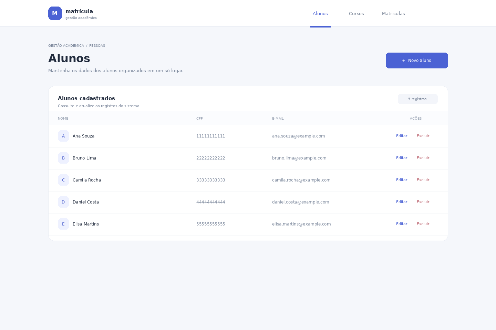
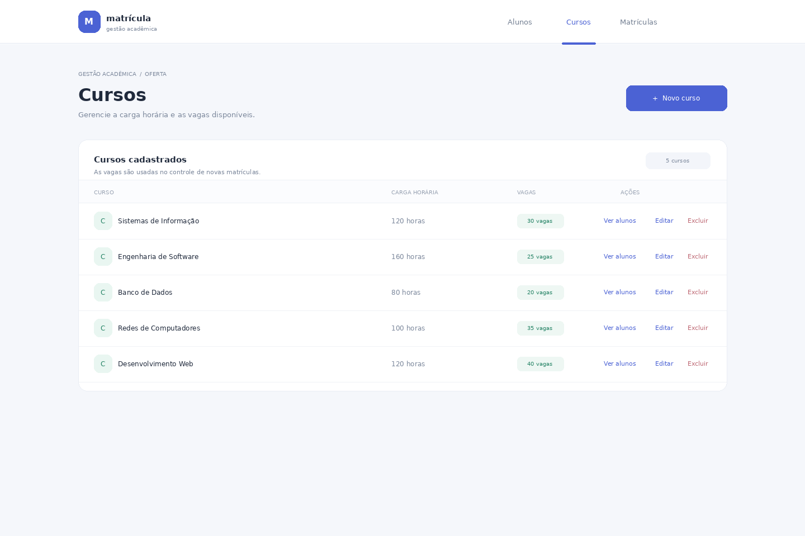
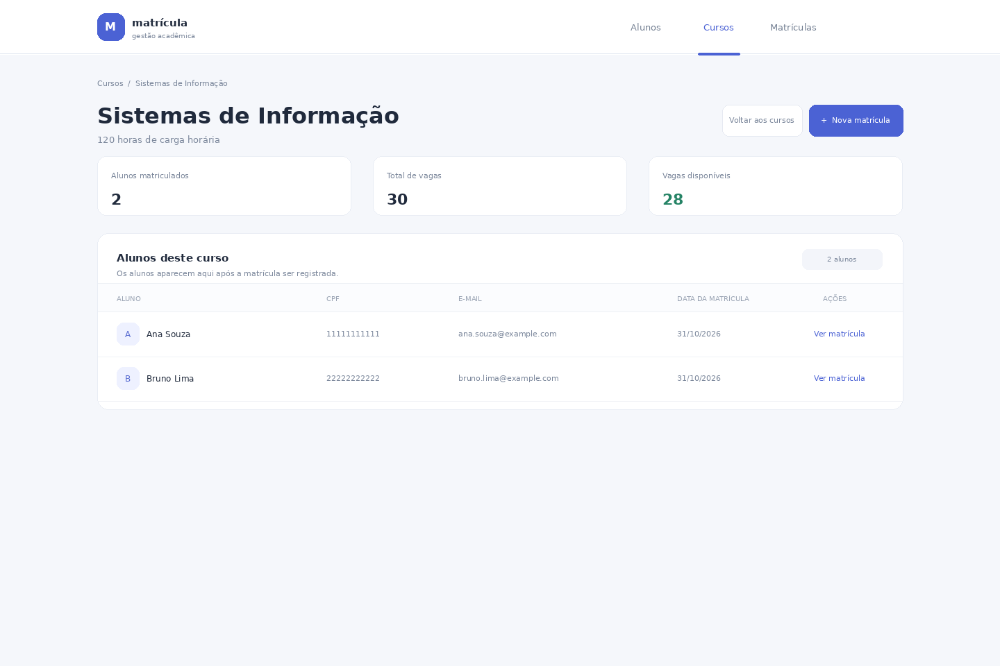
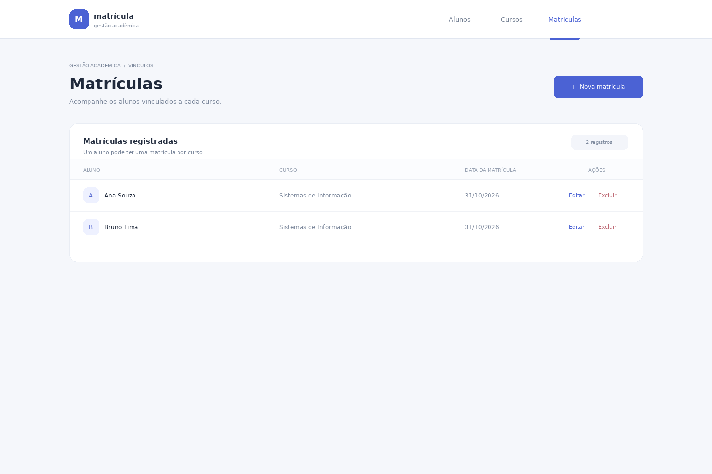

# Sistema de Matrícula

Aplicação web acadêmica em Java com Spring MVC, Thymeleaf e MongoDB para gerenciar alunos, cursos e matrículas.

O projeto organiza a aplicação em camadas MVC: controladores recebem as requisições, serviços aplicam as regras de negócio, repositórios acessam o MongoDB e templates Thymeleaf renderizam as páginas.

## Executar com Docker

Na raiz do projeto, execute:

```bash
docker compose up --build
```

Depois, acesse [http://localhost:8080](http://localhost:8080). O Docker Compose inicia o MongoDB e aguarda o banco ficar disponível antes de iniciar a aplicação. Os dados ficam no volume `mongodb_data`.

## Executar localmente

Requisitos: Java 21, Maven e MongoDB disponível em `localhost:27017`.

```bash
mvn spring-boot:run
```

A URI pode ser alterada pela variável de ambiente `SPRING_DATA_MONGODB_URI`. O valor padrão é `mongodb://localhost:27017/matricula_db`.

## Funcionalidades

- Cadastro, consulta, edição e exclusão de alunos, com CPF único e validação de e-mail.
- Cadastro, consulta, edição e exclusão de cursos, com carga horária e limite de vagas.
- Cadastro, consulta, edição e exclusão de matrículas entre alunos e cursos.
- Consulta dos alunos matriculados, seus dados e as vagas disponíveis em cada curso pela ação **Ver alunos**.
- Bloqueio de matrículas duplicadas e de novas matrículas quando todas as vagas do curso estão ocupadas.
- Proteção contra a exclusão de alunos e cursos que ainda tenham matrículas vinculadas.
- Validação dos formulários no servidor e mensagens de erro junto aos campos.

## Prévia das telas

As imagens abaixo são prévias ilustrativas dos templates, geradas com dados demonstrativos. A aplicação não estava em execução nesta sessão, então elas não são capturas de uma execução ao vivo. A carga inicial cria alunos e cursos, mas não cria matrículas; os vínculos mostrados nas duas últimas telas são apenas exemplos visuais.

### Alunos



### Cursos



### Alunos matriculados em um curso



### Matrículas



As páginas são renderizadas no servidor com Thymeleaf. As rotas principais são:

- `/alunos` — gerenciamento de alunos.
- `/cursos` — gerenciamento de cursos.
- `/cursos/{id}` — detalhes do curso e alunos matriculados.
- `/matriculas` — gerenciamento de matrículas.

Na inicialização, a aplicação completa as coleções de alunos e cursos até haver cinco registros em cada uma, sem sobrescrever os registros existentes. Os dados de exemplo são demonstrativos; matrículas não são criadas automaticamente.

## Estrutura do projeto

- `controller/` — controladores MVC e rotas web.
- `service/` — regras de negócio e dados de apresentação.
- `model/` — entidades persistidas no MongoDB.
- `repository/` — consultas e operações de persistência.
- `src/main/resources/templates/` — páginas Thymeleaf.
- `src/main/resources/static/` — arquivos CSS e demais recursos estáticos.

O relatório acadêmico em Markdown e DOCX fica na pasta local `docs/`. Essa pasta está listada no `.gitignore` e não é incluída no controle de versão.
